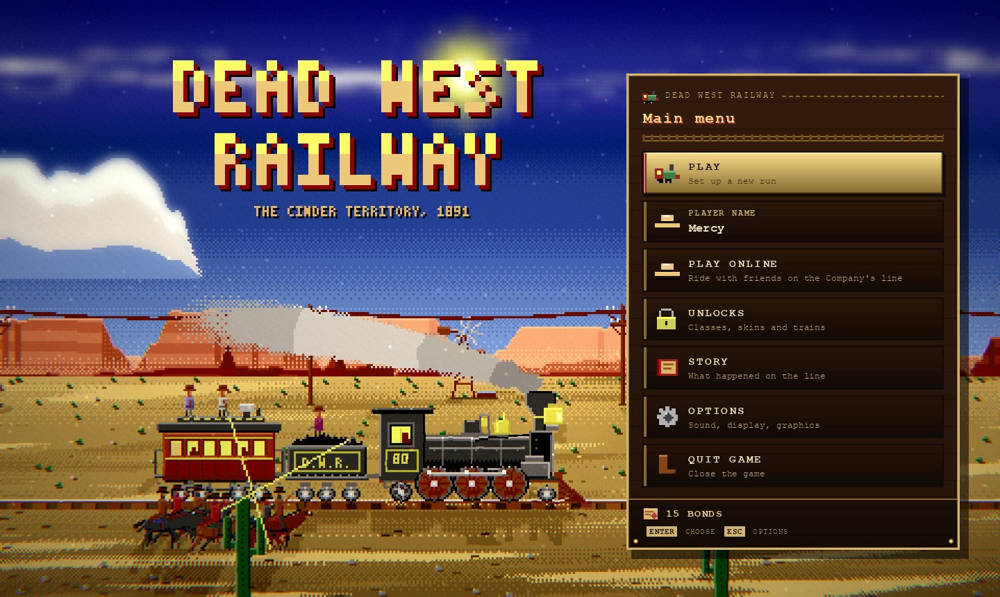
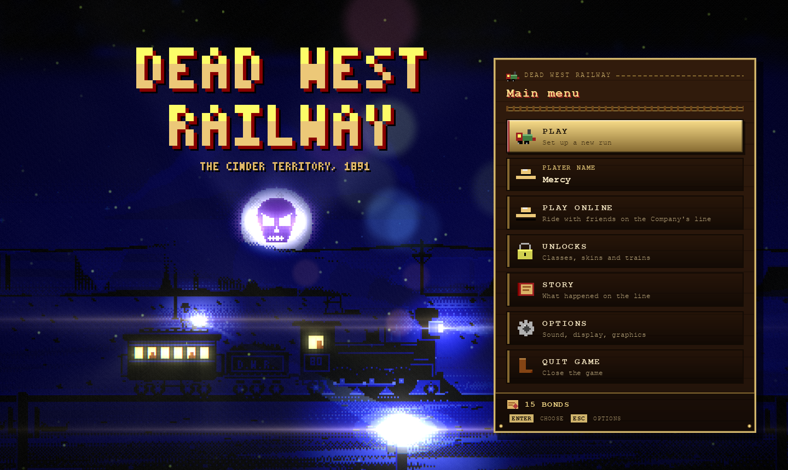
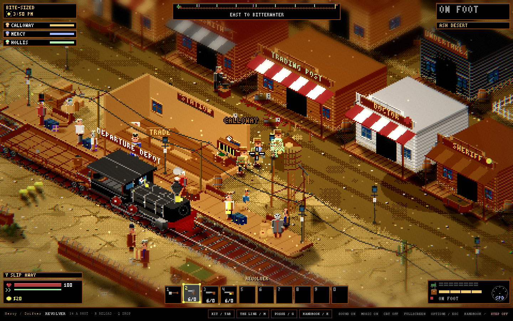
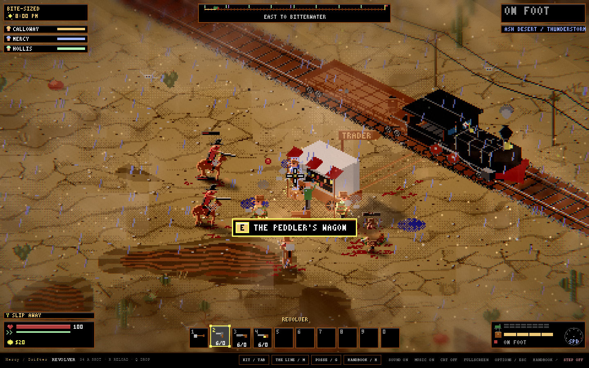
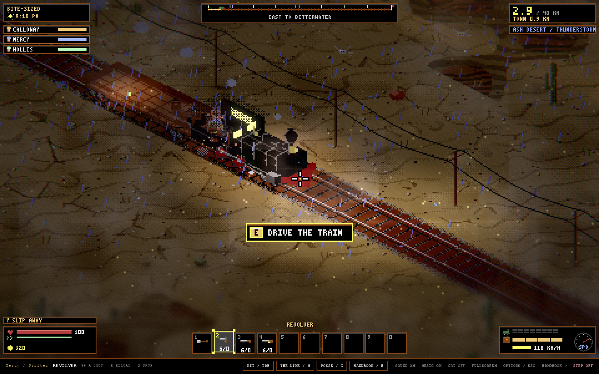
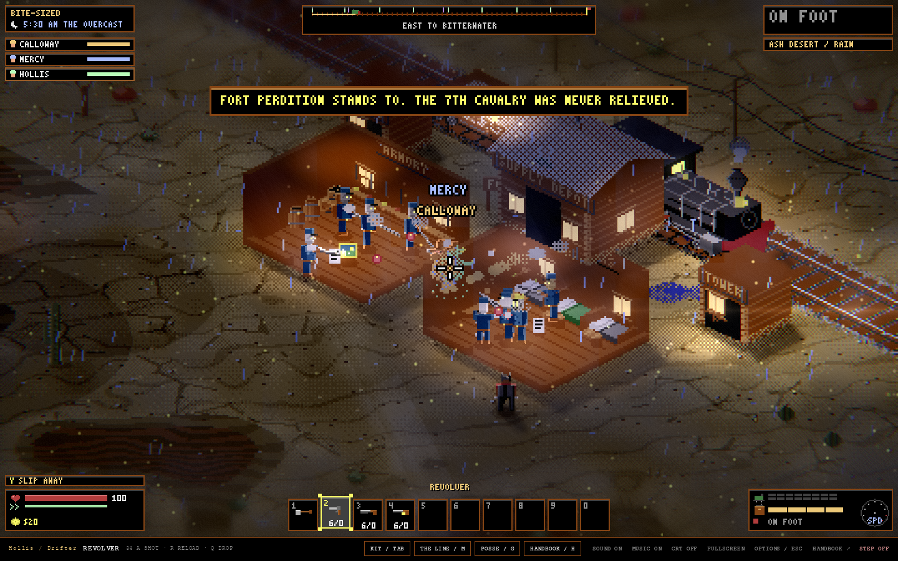
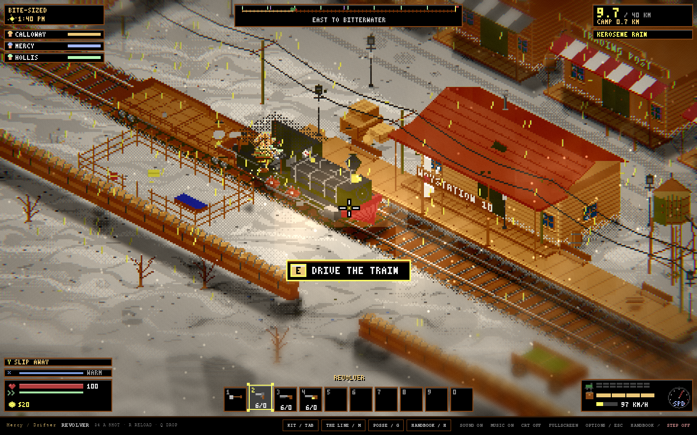
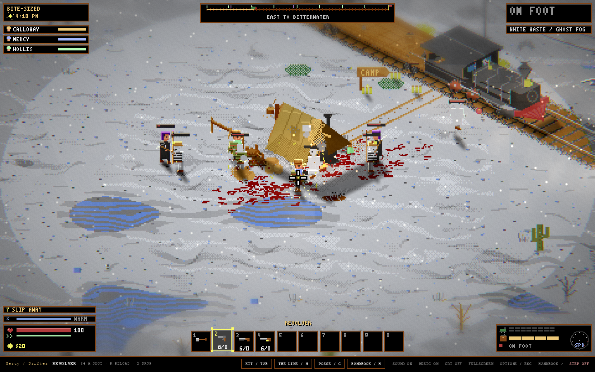
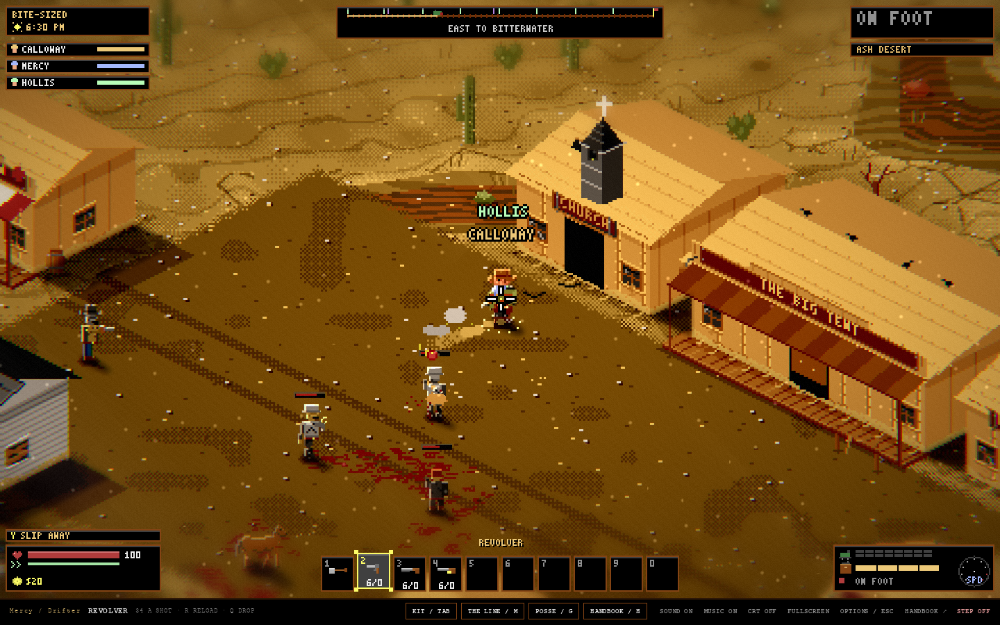
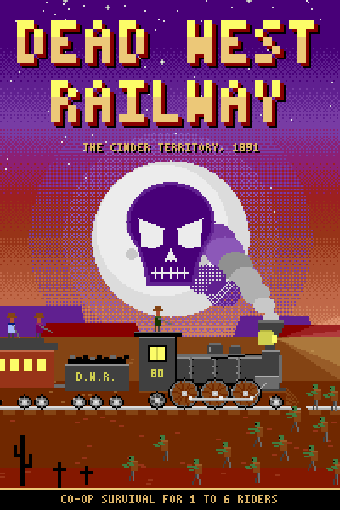

# Dead West Railway

[](https://ko-fi.com/speakerjosh)

<p align="center"></p>

A co-op survival game for one to six players on Windows, macOS and Linux. Drive a steam train 80 kilometres down a frontier line with your friends: keep the boiler fed, scavenge the towns, and get through the nights. Play online, with friends on your own network, with a second player at the same screen on a controller, or alone with no internet.

<p align="center"></p>

<p align="center">
  
  
</p>
<p align="center">
  
  
</p>
<p align="center">
  
  
</p>
<p align="center">
  
  
</p>

## Download

| System                               | Installer                                                                                                                                      | Portable                                                                                                                                           |
| ------------------------------------ | ---------------------------------------------------------------------------------------------------------------------------------------------- | -------------------------------------------------------------------------------------------------------------------------------------------------- |
| **Windows** 10 or 11, 64-bit         | [DeadWestRailway-win-Setup.exe](https://github.com/Joshspeakman/dead-west-railway-cs/releases/latest/download/DeadWestRailway-win-Setup.exe) | [DeadWestRailway-win-Portable.zip](https://github.com/Joshspeakman/dead-west-railway-cs/releases/latest/download/DeadWestRailway-win-Portable.zip) |
| **macOS** 12 or newer, Apple Silicon | [DeadWestRailway-osx-Setup.pkg](https://github.com/Joshspeakman/dead-west-railway-cs/releases/latest/download/DeadWestRailway-osx-Setup.pkg)   | [DeadWestRailway-osx-Portable.zip](https://github.com/Joshspeakman/dead-west-railway-cs/releases/latest/download/DeadWestRailway-osx-Portable.zip) |
| **Linux** 64-bit, any distribution   | [DeadWestRailway.AppImage](https://github.com/Joshspeakman/dead-west-railway-cs/releases/latest/download/DeadWestRailway.AppImage)             |                                                                                                                                                    |

Every version is on the [releases page](https://github.com/Joshspeakman/dead-west-railway-cs/releases). The installed game checks for a new version when it starts and asks before it updates.

## Install

The game isn't signed with a paid publisher certificate yet, so Windows and macOS ask you to confirm the first time. That's expected.

### Windows

1. Run **DeadWestRailway-win-Setup.exe**.
2. If Windows shows **"Windows protected your PC"**, click **More info**, then **Run anyway**.
3. The game installs for your user account and opens. It adds itself to the Start menu and the desktop.

To uninstall, go to **Settings → Apps → Installed apps → Dead West Railway → Uninstall**.

The portable zip needs no install: unzip it anywhere and run **Dead West Railway.exe**.

### macOS

1. Open **DeadWestRailway-osx-Setup.pkg**. If macOS says it can't verify the developer, click **Done**.
2. Open **System Settings → Privacy & Security**, scroll down to the message about the installer, and click **Open Anyway**. Confirm with your password.
3. Go through the installer. **Dead West Railway** is then in Applications.

On macOS 14 or older you can instead right-click the installer, choose **Open**, then **Open** again.

### Linux

Make the AppImage executable and run it:

```sh
chmod +x DeadWestRailway.AppImage
./DeadWestRailway.AppImage
```

If it says no suitable `fusermount` was found, install FUSE (the `fuse3` package on most distributions), or start it with `./DeadWestRailway.AppImage --appimage-extract-and-run`.

## Playing together

- **Online:** **Play Online** takes out a train on the game's server and gives you a ticket code. Friends enter the code to board the same train.
- **On your own network:** host a train from **Play Online** and it appears on your friends' Play Online pages. If a network hides it, enter the host's address (TCP 7893, UDP 7894).
- **At one screen:** a second rider can join with a controller, alone or online.
- **Alone:** **Play** starts a run on your own computer. No internet needed.

The train leaves when every rider aboard is ready.

## The game



- An 80 km line from the Departure Depot to Bitterwater Crossing. A fortified town every 10 km has a gunsmith, a doctor, a general store, a trading post, a sheriff and an undertaker; smaller towns, forts and camps lie between. The country between them is different every run.
- A day lasts eight minutes. Most nights bring the dead: an overcast night sends them running, and a full moon brings werewolves and wolf packs. A storm brings lightning instead. By day, outlaws on horseback ride the open country.
- The train burns coal, and chairs, barrels and the dead when coal runs short. One rider drives, others feed the firebox and keep the dead off the cars.
- 35 classes. Each has its own move, and a mastery track that unlocks two abilities.
- Run modes include Normal, Nightmare, Bite-Sized (40 km), Deep Freeze, Ticking Clock, Endless, Permadeath, Free-for-All, and Horsing Around (no train; every rider is a horse).
- Two looks: **Classic** (the plain pixel art) and **Enhanced** (smooth lighting, soft shadows, fog, bloom, god rays and more). Each effect can be turned on or off.
- Keyboard and mouse, or a controller (Xbox, PlayStation or any standard gamepad). The game shows the buttons of the controller you use.

## Controls

| Key                | What it does                                               |
| ------------------ | ---------------------------------------------------------- |
| W A S D            | Walk. In the driver's seat: throttle and brake             |
| Mouse, left click  | Aim and shoot. With a blade, hold to wind up               |
| Right mouse (hold) | Aim down the sights                                        |
| Shift              | Run                                                        |
| Left Ctrl          | Sneak                                                      |
| Space              | Hop, or get up from a seat or saddle                       |
| Space twice        | Diving roll                                                |
| E                  | Use, pick up, buy, take the controls. Hold for longer jobs |
| R                  | Reload                                                     |
| F                  | Use the selected item                                      |
| Q                  | Drop. Hold to count out money                              |
| V                  | Quick heal. In the driver's seat: the whistle              |
| T, B               | Your class's two abilities                                 |
| Y                  | Your class's own move                                      |
| Z                  | Weld what you carry to the train                           |
| X                  | The sack                                                   |
| 1–0, mouse wheel   | Choose from your belt                                      |
| Tab, M, G          | Your things, the map, your posse                           |
| Enter              | Chat                                                       |
| C (hold)           | Gestures                                                   |
| H                  | The handbook                                               |
| Esc                | Options                                                    |
| F11 (Mac: Cmd+F)   | Fullscreen                                                 |

Press **H** in the game for the full handbook, including the controller layout.

## Dead West Railway Classic

The original browser-built game is [Dead West Railway Classic](https://github.com/Joshspeakman/dead-west-railway). It keeps its own releases and its own server. New work goes into this version.

## Insert Coin

If you had fun with this, you can buy me a Continue on Ko-fi. It's $5 and it keeps me making games like this.

[](https://ko-fi.com/speakerjosh)

---

© 2026 Joshspeakman. All rights reserved.
